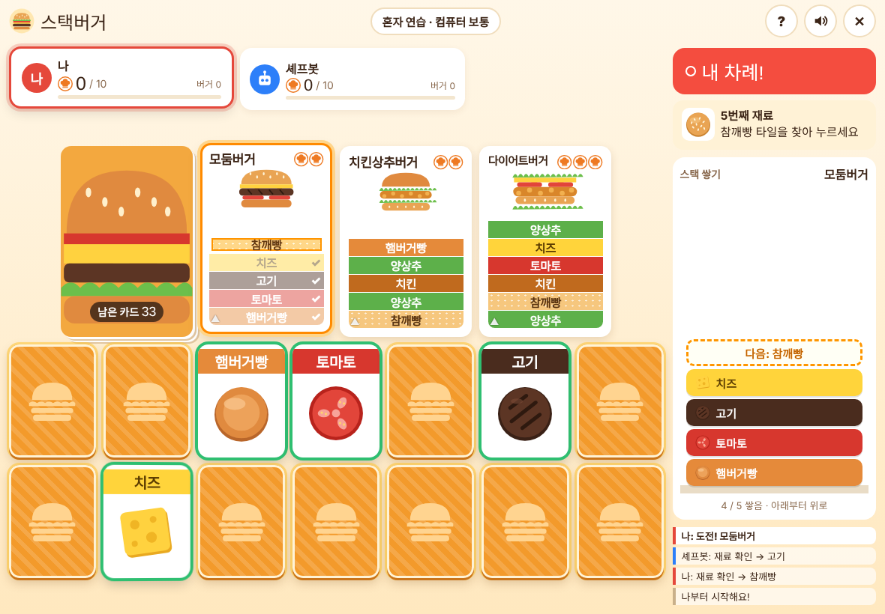

# 스택버거 온라인

버거 재료를 **아래부터 순서대로** 쌓는 기억력 보드게임 「스택버거」를 교실에서 쓸 수 있게 다시 만든 웹앱입니다. 2~4명이 각자 태블릿으로 같은 판을 보며 함께 하거나, 컴퓨터와 1:1로 연습할 수 있습니다.

- **웹으로 바로 열기:** https://shushussam.github.io/ai/stackburger/

## 게임 방법

| 단계 | 내용 |
|---|---|
| 준비 | 버거 카드 3장을 펼치고, 재료타일(7종류)을 뒤집어 놓습니다. |
| 내 차례 ① 재료 확인 | 타일 1장을 뒤집어 **모두가 함께 본 뒤** 다시 덮습니다. 차례가 넘어갑니다. |
| 내 차례 ② 도전! | 버거 카드를 고르고, 카드에 적힌 **맨 아래 재료부터 순서대로** 타일을 찾습니다. |
| 성공 | 버거 카드를 가져가고 카드의 요리사 모자 수만큼 점수를 얻습니다. 한 번 더 도전할 수 있습니다. |
| 실패 | 뒤집은 타일을 모두 덮고 차례가 넘어갑니다. |
| 승리 | 요리사 모자 10개를 가장 먼저 모으면 승리합니다. |

## 주요 기능

| 구분 | 내용 |
|---|---|
| 혼자 연습하기 | 컴퓨터 셰프봇(쉬움·보통·어려움)과 1:1 대결. 컴퓨터도 사람처럼 기억하고, 시간이 지나면 잊거나 헷갈립니다. 인터넷 없이도 됩니다. |
| 온라인 대전 | 방장이 방을 만들면 6자리 방 번호와 QR이 나옵니다. 2~4명이 각자 태블릿으로 입장하고, 빈자리는 컴퓨터로 채울 수 있습니다. |
| 관전 모드 | 교실 TV나 교사용 큰 화면에서 게임을 함께 지켜봅니다. |
| 게임 설정 | 재료타일 14·21·28장, 목표 모자 10·15·20개, 공개 카드 3~5장, 확인 시간 2·3·5초, 제한 시간, 성공 후 추가 도전 여부 |
| 스택 쌓기 | 도전하면 재료가 아래부터 쌓이는 모습이 보여, 자료구조 '스택(push)' 개념과 연결할 수 있습니다. |
| 연결 안정성 | 학생 태블릿이 끊기면 자동으로 다시 연결되고, 방장 화면이 닫혀도 '이어하기'로 복구합니다. |

## 선생님 사용 안내

1. 선생님 태블릿에서 링크를 열고 **[방 만들기]**를 누릅니다.
2. 화면의 **QR을 학생 태블릿 카메라로 찍거나**, 학생이 **[방 참여하기]**에서 방 번호 6자리를 입력합니다.
3. 2명 이상 모이면 **[게임 시작]**을 누릅니다.

> 방장 태블릿이 심판 역할을 하므로 게임이 끝날 때까지 방장 화면을 켜 두세요. 태블릿끼리 인터넷으로 직접 연결(PeerJS)하므로 학교망에서 연결이 막히면 다른 네트워크(핫스팟 등)로 시도해 보세요.

## 참고

- 원작: 다즐에듀 「스택버거」 보드게임. 그림은 모두 이 웹앱에서 새로 그렸습니다.
- 햄버거 카드 36장 중 27장은 원작 자료에서 확인한 레시피이고, 9장은 같은 분포(점수·재료 수)로 새로 설계했습니다.
- 파일 하나(`index.html`)에 필요한 라이브러리(PeerJS, QR 코드 생성기, MIT 라이선스)가 모두 들어 있습니다.
