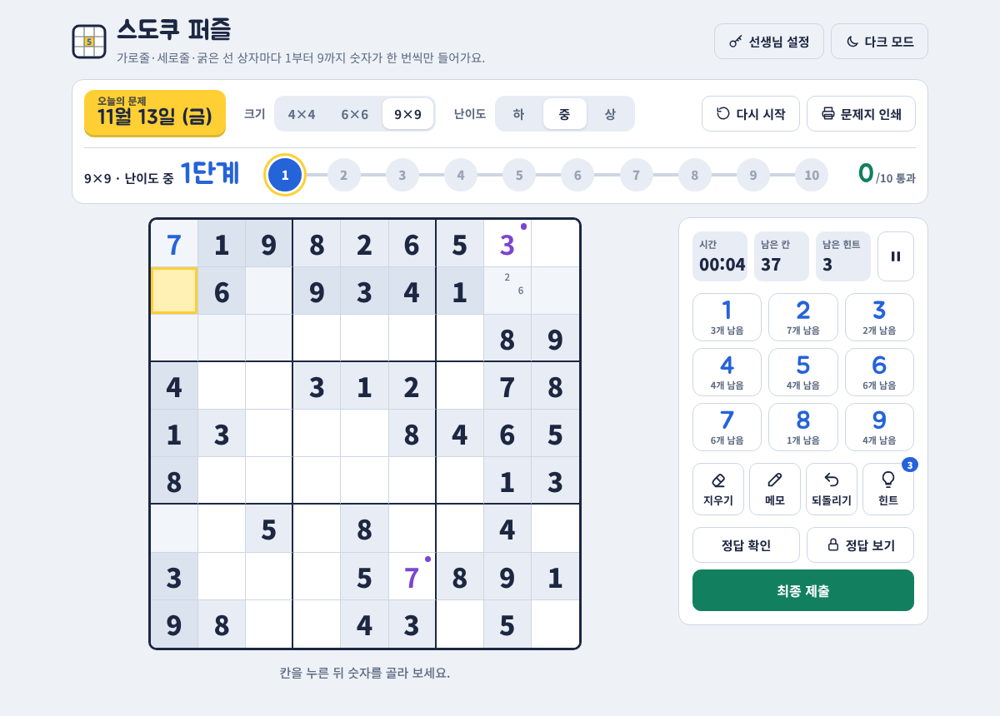

# 스도쿠 퍼즐 교실

초등학교 교실에서 쓰는 스도쿠 웹앱입니다. 같은 날에는 우리 반 학생 모두가 **똑같은 문제**를 1단계부터 10단계까지 풀고, 서로 몇 단계까지 왔는지 비교할 수 있습니다.

- **웹으로 바로 열기:** https://jinsu10247974-stack.github.io/ai/sudoku/
- **윈도우용 exe 내려받기:** [SudokuClassroom-v1.0.exe](https://github.com/jinsu10247974-stack/ai/releases/download/sudoku-v1.0.0/SudokuClassroom-v1.0.exe) (약 109MB)



## 주요 기능

| 구분 | 내용 |
|---|---|
| 오늘의 문제 | 날짜(한국 시간)·크기·난이도·단계가 같으면 어느 기기에서나 같은 문제가 나옵니다. 자정이 지나면 새 문제로 바뀝니다. |
| 1~10단계 | 크기(4×4·6×6·9×9)와 난이도(하·중·상)마다 10단계가 있고, 단계가 오를수록 빈칸이 늘어납니다. 앞 단계를 통과해야 다음 단계가 열립니다. |
| 풀이 도움 | 메모(후보 숫자), 되돌리기, 겹친 숫자 빨간 표시, 같은 숫자 강조, 완성된 숫자 초록 표시 |
| 힌트 | 단계마다 5개까지 시간 추가 없이 사용할 수 있고, 그 뒤로는 1회에 5초씩 기록에 더해집니다. |
| 정답 보기 | 선생님 비밀번호를 넣어야 열립니다. 보는 동안 시간이 멈추며, 선생님이 해당 단계를 건너뛰게 할 수 있습니다. |
| 문제지 인쇄 | 오늘의 1~10단계 문제지와 정답지를 A4로 인쇄합니다(학년·반·번호·이름 칸 포함). exe에서는 PDF로 저장됩니다. |
| 기록 | 진행 상황은 각 기기의 브라우저(또는 exe)에 저장되어, 다시 열어도 풀던 단계부터 이어집니다. |

## 선생님 사용 안내

1. 오른쪽 위 **[선생님 설정]**을 누릅니다. 처음 비밀번호는 **1234**입니다.
2. 1234를 넣고, 선생님만 아는 새 비밀번호(숫자 4~8자리)를 저장합니다.
3. 새로 만들어진 **우리 반 링크**를 복사해 학생들에게 나눠 줍니다.
   - 이 링크로 한 번 들어온 기기는 정답 보기에 선생님 비밀번호를 씁니다.
   - exe를 쓰는 컴퓨터는 [선생님 설정] → '우리 반 링크로 비밀번호 적용하기'에 링크를 붙여 넣습니다.
4. 수업 전에 "오늘은 6×6 하"처럼 **크기와 난이도를 정해 주면** 학생들끼리 단계를 비교하기 좋습니다.

> 서버 없이 각 기기에서만 동작하므로, 비밀번호는 교실에서 쓰는 잠금 정도의 보호입니다. 학생 기록도 선생님 화면에 모이지 않습니다.

## exe 실행 안내 (윈도우 10·11, 64비트)

- 설치 없이 더블클릭하면 실행됩니다. 실행할 때마다 압축을 풀어 창이 뜨기까지 몇 초 걸립니다.
- 서명되지 않은 프로그램이라 처음에 "Windows의 PC 보호" 창이 뜨면 **[추가 정보] → [실행]**을 누릅니다.
- **F11** 전체 화면, **Ctrl + / Ctrl -** 확대·축소, **Ctrl 0** 원래 크기
- 재부팅하면 처음 상태로 돌아가는 복원 프로그램이 깔린 PC에서는 기록과 적용한 비밀번호가 지워집니다.

## 저장소 구성

```
index.html              웹앱 (GitHub Pages로 공개되는 파일, ai/sudoku/)
web/src/app.html        화면·기능 소스
web/src/engine.js       문제 생성 엔진 (날짜별 고정 난수, 유일해 검증)
web/build.py            두 파일을 합쳐 index.html을 만든다
desktop/                윈도우용 exe (Electron)
  main.js, preload.js   창·PDF 저장
  build-app.py          index.html + 글꼴을 app 폴더로 정리
  scripts/afterPack.js  exe 아이콘·한글 파일 정보 넣기
docs/screenshot.png     README 화면
```

### 고치고 다시 만들기

```bash
# 1) 웹앱: web/src 를 고친 뒤
python3 web/build.py            # index.html 갱신 → 커밋하면 GitHub Pages에 반영

# 2) exe: Node.js 20 이상
cd desktop
npm install
npm run dist                    # dist/SudokuClassroom-1.0.0-portable.exe 생성
```
