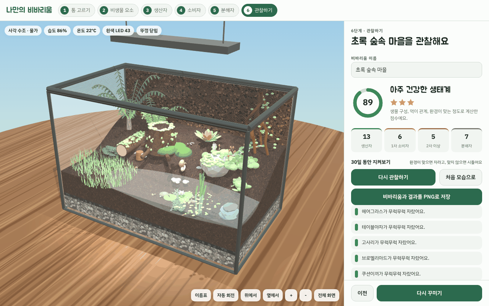

# 나만의 비바리움

초등 과학 '생태계' 수업에서 쓰는 3D 생태계 만들기 웹앱입니다. 유리통을 고르고 흙·물·빛을 채운 뒤 생산자·소비자·분해자를 넣어 나만의 비바리움을 꾸미고, 생태계 점수와 먹이 그물, 30일 동안의 변화를 관찰합니다.

- **웹으로 바로 열기:** https://shushussam.github.io/ai/vivarium/



## 만드는 순서 (6단계)

| 단계 | 하는 일 |
|---|---|
| 1. 통 고르기 | 원기둥 유리병, 사각 수조, 세로형 사육장, 둥근 어항, 육각 테라리움, 유리 돔, 호리병 중 하나를 고릅니다. 모양에 따라 공기와 습기가 머무는 정도가 달라집니다. |
| 2. 비생물 요소 | 흙, 땅 모양, 물, 빛, 온도·공기, 돌·나무를 정합니다. |
| 3. 생산자 | 이끼, 고사리, 피토니아 같은 식물을 골라 흙 위를 눌러 심습니다. |
| 4. 소비자 | 1차 소비자(달팽이, 귀뚜라미, 송사리 등)와 2차 이상 소비자(청개구리, 깡충거미, 장지뱀 등)를 넣습니다. |
| 5. 분해자 | 공벌레, 지렁이, 톡토기, 버섯 등 분해자를 넣습니다. |
| 6. 관찰하기 | 생태계 점수와 먹이 그물을 확인하고, 30일 동안의 변화를 지켜본 뒤 결과를 PNG로 저장합니다. |

## 주요 기능

| 구분 | 내용 |
|---|---|
| 생태계 점수 | 생물 구성, 먹이 관계, 환경이 맞는 정도를 따져 100점 만점 점수와 별점으로 보여 줍니다. |
| 먹이 그물 | 넣은 생물 사이의 먹고 먹히는 관계를 그림으로 그려 줍니다. |
| 30일 관찰 | 습도·온도·빛·흙이 맞는 생물은 자라고, 맞지 않는 생물은 시드는 모습을 보여 줍니다. |
| 완성 예시 | 처음 화면의 **[완성 예시 둘러보기]**로 잘 꾸민 비바리움을 먼저 살펴볼 수 있습니다. |
| 이어서 만들기 | 만들던 내용이 각 기기의 브라우저에 저장되어, 다시 열면 이어서 만들 수 있습니다. |
| 화면 조작 | 끌어서 돌리기, 이름표, 자동 회전, 위에서·옆에서 보기, 확대·축소, 전체 화면 |
| 키보드 | 고른 생물 지우기 **Delete / Backspace**, 선택 풀기 **Esc** |
| 결과 저장 | 비바리움 모습과 점수·관찰 결과를 PNG 그림 한 장으로 저장합니다. |

## 선생님 사용 안내

1. 위의 **웹으로 바로 열기** 링크(또는 QR 코드)를 학생들에게 나눠 줍니다. 로그인이나 설치가 필요 없습니다.
2. 수업을 시작할 때 **[완성 예시 둘러보기]**로 목표 모습을 함께 살펴봅니다.
3. 학생들이 1~6단계를 차례로 진행하며 비바리움을 만듭니다.
4. 6단계에서 **[비바리움과 결과를 PNG로 저장]**을 눌러 그림을 저장하고, 패들렛이나 구글 클래스룸 등에 제출하게 합니다.
5. 교실 화면에 띄울 때는 3D 화면 오른쪽 아래 **[전체 화면]**을 누릅니다.

> 서버 없이 각 기기에서만 동작하므로 학생 결과가 선생님 화면에 모이지 않습니다. 결과는 PNG로 저장해 제출하게 해 주세요. 재부팅하면 초기화되는 복원 프로그램이 깔린 PC에서는 '이어서 만들기' 기록이 지워집니다.

## 사용 환경

- 크롬, 엣지, 웨일, 사파리 최신 버전 (3D 표시를 위해 WebGL 지원 필요)
- 데스크톱·노트북·크롬북·태블릿·휴대폰 모두 사용 가능
- 3D 엔진(three.js)과 글꼴을 인터넷에서 불러오므로 인터넷 연결이 필요합니다.

## 저장소 구성

```
index.html            웹앱 한 파일 (GitHub Pages로 공개되는 파일, ai/vivarium/)
docs/screenshot.png   README 화면
```

### 고치고 다시 올리기

`index.html`을 고친 뒤 커밋하면 1~2분 뒤 GitHub Pages에 반영됩니다.
